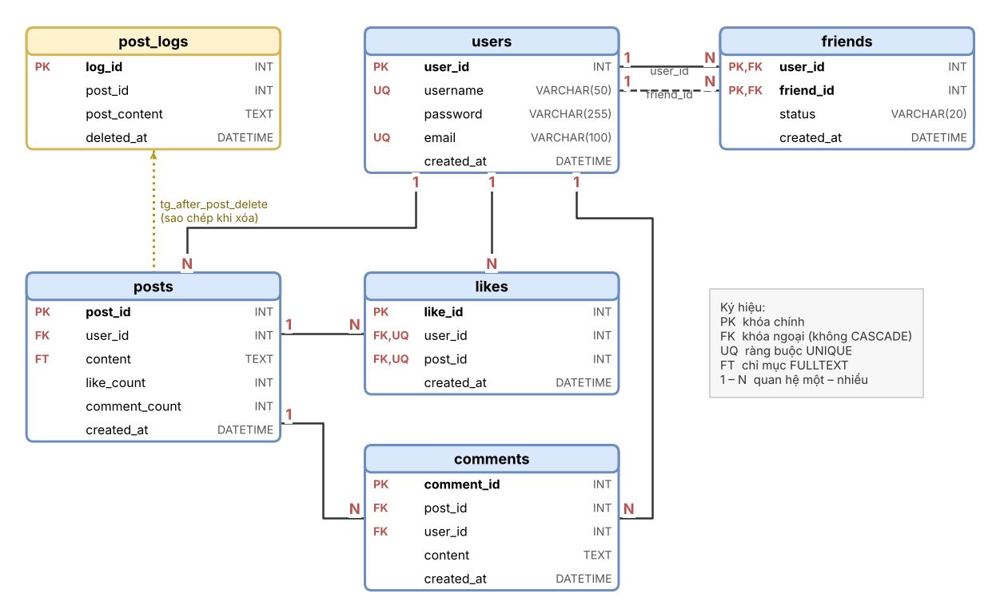

# Mini Project: Database "Social Network" (Trigger và Transaction)

Xây dựng phân hệ xử lý dữ liệu cho một mạng xã hội thu nhỏ trên MySQL 8.0: đóng gói nghiệp vụ thành View và Stored Procedure, dùng Trigger để tự động hóa bộ đếm tương tác và kiểm soát kết bạn, dùng Transaction để xóa tài khoản toàn vẹn theo nguyên tắc All-or-Nothing (ACID).

## 1. Mục tiêu và phạm vi

| # | Chức năng | Đối tượng | Kỹ thuật chính |
|---|---|---|---|
| 1 | Khung nhìn hồ sơ | View `view_user_info` | Chỉ lộ cột an toàn, ẩn `password` |
| 2 | Đăng ký tài khoản | Procedure `sp_add_user` | Kiểm tra trùng email, username; `SIGNAL` báo lỗi |
| 3 | Tự động đếm tương tác | 4 Trigger `tg_after_like_insert/delete`, `tg_after_comment_insert/delete` | Cộng/trừ `like_count`, `comment_count`; chặn giá trị âm |
| 4 | Thống kê hoạt động | Procedure `sp_user_activity_report` | `LEFT JOIN` 4 bảng, `COUNT` + `GROUP BY` |
| 5 | Xóa tài khoản toàn vẹn | Procedure `sp_delete_user` | `TRANSACTION`, xóa từ bảng con lên bảng cha, `ROLLBACK` khi lỗi |
| 6 | Kiểm soát kết bạn | Trigger `tg_before_friend_insert` | Chặn 3 lỗi bằng `SIGNAL SQLSTATE` |
| + | Nhật ký lưu vết | Bảng `post_logs`, Trigger `tg_after_post_delete` | Sao chép nội dung bài viết bị xóa |

**Quy chuẩn kỹ thuật chung:**

- 100% tên bảng, cột, thủ tục, trigger theo `snake_case`.
- Có đầy đủ khóa ngoại nhưng **không dùng `ON DELETE CASCADE`**; việc xóa dữ liệu liên quan được xử lý thủ công qua Transaction.
- Bảng `likes` có `UNIQUE(user_id, post_id)`.
- Chỉ mục Full-Text trên `posts.content`.
- Dữ liệu mẫu có ít nhất 3 users, 3 posts và các tương tác like, comment, kết bạn.

## 2. Phân tích và thiết kế

### 2.1. Các bảng dữ liệu

| Bảng | Vai trò | Khóa chính | Khóa ngoại / ràng buộc |
|---|---|---|---|
| `users` | Tài khoản người dùng | `user_id` | `UNIQUE(username)`, `UNIQUE(email)` |
| `posts` | Bài viết, kèm 2 bộ đếm `like_count`, `comment_count` | `post_id` | `user_id` → `users`; `FULLTEXT(content)` |
| `likes` | Lượt thích | `like_id` | `user_id` → `users`, `post_id` → `posts`; `UNIQUE(user_id, post_id)` |
| `comments` | Bình luận | `comment_id` | `post_id` → `posts`, `user_id` → `users` |
| `friends` | Lời mời và quan hệ bạn bè | `(user_id, friend_id)` | `user_id` → `users`, `friend_id` → `users`; `CHECK status` |
| `post_logs` | Nhật ký bài viết bị xóa | `log_id` | Không có khóa ngoại (bài gốc đã bị xóa) |

### 2.2. Mối quan hệ

| Bảng 1 | Bảng 2 | Quan hệ | Ý nghĩa |
|---|---|---|---|
| users | posts | 1 – N | Một người đăng nhiều bài |
| users | likes | 1 – N | Một người thích nhiều bài |
| posts | likes | 1 – N | Một bài có nhiều lượt thích |
| users | comments | 1 – N | Một người viết nhiều bình luận |
| posts | comments | 1 – N | Một bài có nhiều bình luận |
| users | friends | 1 – N (2 lần) | `friends` tham chiếu `users` hai lần: người gửi (`user_id`) và người nhận (`friend_id`) |

Bảng `likes` thực chất là bảng nối của quan hệ N – N giữa `users` và `posts`; ràng buộc `UNIQUE(user_id, post_id)` bảo đảm mỗi người chỉ thích một bài một lần.

### 2.3. Sơ đồ ERD



[Mở sơ đồ ERD trên draw.io](https://www.draw.io/?title=erd-social-network.drawio#R7Ztbb5swFMc%2FTaTtZQIbCHlMCGzT7l12easscMCqwZFxlmaffubWpIEU1qUuJJOqKr4R8%2FOJ%2F%2Bccwwg68e2SUDwCWsRSMYLzEQABRxvC5IcRdEfQCQgKOYpllwTFuOjiXs3v2uPb1xytog8swLSo4YyJqs3BlMqhJCgGatkw4B1p1fNWbYU4TkSXAQIUI34hui6ntpL3cU1ZmBYtqdjSsiXdkJiiRJZmS5aIr2WLLst%2BRGjwHm3ZOvvaVCD%2FpirNIsbJb9kf0bKzbObiK%2FmdDYZadjVCqcMo4%2Fn3QM%2FzgOPkHTm7wXstc2tmmZZs4WydBDgoL5jPpriebshyeU%2BYC3x7FIy%2BvwCYxVjwrexSDjAKbtq2KMKyuCGBiKqqsi7CJIyqi0KjqERpURHeXXm3CvJDuRDNi%2BLD2qJ8fjfKVnL3JxfoWvaXn%2BFU%2Fn%2F7cVFbLnnzGX5ESZjIGoqXWTGjQnxEp2V1TIIgGzFLV8gnSfg%2B7za3D7CCg0XvjLmwsDrnvwQLrBNwNWpcD6gWf%2FkvQDXcU8A0LYUwzb%2BA6cubzW6iIrpwfw4EqQ0UIrW6IZU6gQUOrtEO6Hy6cBdvP7jDgKprtjqqYlyjuk4xfz55m09d22uUN8ux3ZmnRN4eq2%2BWdgI7t9v1LVuigQjcuD8CN6mB%2FfalAWzuh1Zkv0%2BvnDfTqxem9rIvu8e4Pyqnax1lDqXphvGghhWY5kC4KpU6XW83VRwjQmtAdW0ohqpU5nwddLNUn2PUc%2B%2BhBWsVYynxHvR6MLbkBCfBZTsQtvWcAbJuNHoQjvducN5DYV%2F9cB9082GsheGfB1i1XkTHyE7%2B8sU6rfsQ%2FVG8FqpqfYjx2SheC1a1AbNuNyaFLzxiPtS7roJnn8TUJ%2B0h87OkLR%2B5N9v9ET1Qj%2FC8XmQjToJSqcyBelDnLQ434x6ngltYKhU30DGco%2BQGy%2Fz6eg%2FpcKxTbYQMYEd%2FgcWxvIXhUlUZIPvAOB8vrIWrpVCXBKgHY9lv%2Ff%2B5xePcsJPkHYDV4WQ%2B25AHcjRv9sgNGze6YU6VFe6xC9aCUa0LZj%2BMsc%2FPNpg98r4mZyNqLVjVphZgPdgqva3%2Furava8ZE6YE81Nt1rfKKhyFthaH1Q9ogaM8w9HhfbkGpVN4gHHSypgWlUomDXeO2HidsWniqTS9A82x8hjauKhMMGDYdnh1wwkGIK5FgXEQsZAmi7q62FPcf5YT1V6ask4eZU87ZRla4VzFKtpW3cK82%2BJT7ILKzR7JZzrWq2165mFE2jYc9ADlrtuY%2Bvv9sorxYiNuyEBxTJMiv%2B1%2Fwb2THl0X2mCv8BGTtyyJ7bMN4ArKT8yVbHbw%2Bk9Ea2oWhVWe1ht74EHrupp6zlEFlgMGRx%2FR6iThAaXSXThgm73ogJsJrtBTSqPNYtnhJ5fTo2QonJyLYvN0%2BDUFZ3L3VmbcdvvQpK6s3RXed8ndLofsH)

### 2.4. Quyết định thiết kế

- **Không dùng `ON DELETE CASCADE`:** khóa ngoại để mặc định (`RESTRICT`), nên không thể xóa `users` hoặc `posts` khi còn dữ liệu con. Việc dọn dữ liệu được thực hiện tường minh trong `sp_delete_user`, nhờ vậy người lập trình kiểm soát được thứ tự xóa, và Trigger đếm tương tác lẫn Trigger lưu vết vẫn được kích hoạt đúng.
- **Bộ đếm lưu sẵn trong `posts`:** trang bảng tin chỉ cần đọc `like_count`, `comment_count` thay vì `COUNT` lại bảng `likes`, `comments` mỗi lần hiển thị. Trigger giữ cho bộ đếm luôn khớp với dữ liệu thật.
- **`likes` có khóa chính riêng `like_id`:** đề bài yêu cầu `UNIQUE(user_id, post_id)` nên khóa chính dùng cột tự tăng, còn tính duy nhất do ràng buộc `UNIQUE` đảm nhiệm.
- **Mật khẩu:** lưu chuỗi băm `SHA2(..., 256)`, không lưu mật khẩu gốc. Trong hệ thống thật nên băm ở tầng ứng dụng bằng thuật toán có salt như bcrypt hoặc Argon2.
- **Engine InnoDB:** bắt buộc để có Transaction, khóa ngoại và Full-Text Search trên cùng một bảng.

## 3. Triển khai cấu trúc

### 3.1. Tạo bảng

```sql
DROP DATABASE IF EXISTS social_network;
CREATE DATABASE social_network CHARACTER SET utf8mb4 COLLATE utf8mb4_unicode_ci;
USE social_network;

CREATE TABLE users (
    user_id    INT AUTO_INCREMENT PRIMARY KEY,
    username   VARCHAR(50)  NOT NULL,
    password   VARCHAR(255) NOT NULL,                -- lưu chuỗi băm SHA2, không lưu mật khẩu gốc
    email      VARCHAR(100) NOT NULL,
    created_at DATETIME     NOT NULL DEFAULT CURRENT_TIMESTAMP,
    CONSTRAINT uq_users_username UNIQUE (username),
    CONSTRAINT uq_users_email    UNIQUE (email)
) ENGINE = InnoDB;

CREATE TABLE posts (
    post_id       INT AUTO_INCREMENT PRIMARY KEY,
    user_id       INT      NOT NULL,
    content       TEXT     NOT NULL,
    like_count    INT      NOT NULL DEFAULT 0,       -- Trigger tự cập nhật
    comment_count INT      NOT NULL DEFAULT 0,       -- Trigger tự cập nhật
    created_at    DATETIME NOT NULL DEFAULT CURRENT_TIMESTAMP,
    CONSTRAINT fk_posts_user FOREIGN KEY (user_id) REFERENCES users (user_id),
    FULLTEXT INDEX ft_posts_content (content)        -- tối ưu tìm kiếm nội dung
) ENGINE = InnoDB;

CREATE TABLE likes (
    like_id    INT AUTO_INCREMENT PRIMARY KEY,
    user_id    INT      NOT NULL,
    post_id    INT      NOT NULL,
    created_at DATETIME NOT NULL DEFAULT CURRENT_TIMESTAMP,
    CONSTRAINT uq_likes_user_post UNIQUE (user_id, post_id),   -- mỗi người chỉ like 1 bài 1 lần
    CONSTRAINT fk_likes_user FOREIGN KEY (user_id) REFERENCES users (user_id),
    CONSTRAINT fk_likes_post FOREIGN KEY (post_id) REFERENCES posts (post_id)
) ENGINE = InnoDB;

CREATE TABLE comments (
    comment_id INT AUTO_INCREMENT PRIMARY KEY,
    post_id    INT      NOT NULL,
    user_id    INT      NOT NULL,
    content    TEXT     NOT NULL,
    created_at DATETIME NOT NULL DEFAULT CURRENT_TIMESTAMP,
    CONSTRAINT fk_comments_post FOREIGN KEY (post_id) REFERENCES posts (post_id),
    CONSTRAINT fk_comments_user FOREIGN KEY (user_id) REFERENCES users (user_id)
) ENGINE = InnoDB;

CREATE TABLE friends (
    user_id    INT         NOT NULL,                 -- người gửi lời mời
    friend_id  INT         NOT NULL,                 -- người nhận lời mời
    status     VARCHAR(20) NOT NULL DEFAULT 'pending',
    created_at DATETIME    NOT NULL DEFAULT CURRENT_TIMESTAMP,
    PRIMARY KEY (user_id, friend_id),
    CONSTRAINT chk_friends_status CHECK (status IN ('pending', 'accepted')),
    CONSTRAINT fk_friends_user   FOREIGN KEY (user_id)   REFERENCES users (user_id),
    CONSTRAINT fk_friends_friend FOREIGN KEY (friend_id) REFERENCES users (user_id),
    INDEX idx_friends_friend (friend_id)
) ENGINE = InnoDB;

-- Mở rộng: nhật ký lưu vết bài viết bị xóa (không có khóa ngoại vì bài gốc đã bị xóa)
CREATE TABLE post_logs (
    log_id       INT AUTO_INCREMENT PRIMARY KEY,
    post_id      INT      NOT NULL,
    post_content TEXT     NOT NULL,
    deleted_at   DATETIME NOT NULL DEFAULT CURRENT_TIMESTAMP
) ENGINE = InnoDB;
```

### 3.2. Chỉ mục

| Chỉ mục | Bảng | Cột | Mục đích |
|---|---|---|---|
| `ft_posts_content` (FULLTEXT) | `posts` | `content` | Tìm kiếm bài viết theo từ khóa bằng `MATCH ... AGAINST`, thay cho `LIKE '%từ khóa%'` không dùng được index |
| `uq_likes_user_post` (UNIQUE) | `likes` | `(user_id, post_id)` | Chống like trùng, đồng thời tăng tốc tra cứu like của một user |
| `idx_friends_friend` | `friends` | `friend_id` | Tăng tốc tìm lời mời theo chiều ngược lại (Trigger kết bạn, xóa tài khoản) |

```sql
SELECT post_id, content
FROM posts
WHERE MATCH (content) AGAINST ('+MySQL' IN BOOLEAN MODE);
```

| post_id | content |
|---|---|
| 1 | Hôm nay mình bắt đầu học MySQL, cảm thấy rất thú vị! |
| 4 | Mẹo tối ưu truy vấn MySQL bằng Index. |

### 3.3. Dữ liệu mẫu

Các Trigger được tạo **trước** khi chèn dữ liệu mẫu, nên `like_count` và `comment_count` không cần nhập tay mà được Trigger tự tính khi chèn `likes`, `comments`.

```sql
INSERT INTO users (username, password, email) VALUES
    ('an_nguyen',  SHA2('An@12345',   256), 'an.nguyen@gmail.com'),
    ('binh_tran',  SHA2('Binh@12345', 256), 'binh.tran@gmail.com'),
    ('cuong_le',   SHA2('Cuong@1234', 256), 'cuong.le@gmail.com'),
    ('dung_pham',  SHA2('Dung@12345', 256), 'dung.pham@gmail.com'),
    ('ha_vu',      SHA2('Ha@1234567', 256), 'ha.vu@gmail.com');        -- user mới, chưa tương tác

INSERT INTO posts (user_id, content) VALUES
    (1, 'Hôm nay mình bắt đầu học MySQL, cảm thấy rất thú vị!'),
    (2, 'Chia sẻ tài liệu về Trigger và Transaction cho mọi người.'),
    (3, 'Cuối tuần này cả nhóm đi Đà Lạt nhé.'),
    (1, 'Mẹo tối ưu truy vấn MySQL bằng Index.'),
    (4, 'Bài viết đầu tiên của mình trên mạng xã hội này.');

INSERT INTO likes (user_id, post_id) VALUES
    (2, 1), (3, 1), (4, 1),
    (1, 2), (3, 2),
    (1, 3),
    (2, 4);

INSERT INTO comments (post_id, user_id, content) VALUES
    (1, 2, 'Cố lên bạn ơi!'),
    (1, 3, 'MySQL dễ mà, học vài tuần là quen.'),
    (2, 1, 'Cảm ơn bạn đã chia sẻ.'),
    (2, 3, 'Tài liệu rất hữu ích.'),
    (2, 4, 'Mình lưu lại để đọc dần.'),
    (4, 2, 'Mẹo hay quá!');

INSERT INTO friends (user_id, friend_id, status) VALUES
    (1, 2, 'accepted'),
    (3, 1, 'accepted'),
    (1, 4, 'accepted'),
    (1, 5, 'pending'),
    (2, 3, 'accepted');
```

| Bảng | Số dòng | Ghi chú |
|---|---|---|
| `users` | 5 | `ha_vu` là user mới chưa có tương tác (kiểm thử `LEFT JOIN`) |
| `posts` | 5 | Bài 5 chưa có like, comment |
| `likes` | 7 | |
| `comments` | 6 | |
| `friends` | 5 | 4 quan hệ `accepted`, 1 lời mời `pending` (1 → 5) |

## 4. Triển khai chức năng

### 4.1. Chức năng 1 – Khung nhìn hồ sơ `view_user_info`

```sql
CREATE OR REPLACE VIEW view_user_info AS
SELECT user_id, username, email, created_at
FROM users;
```

View chỉ chứa 4 cột an toàn. Ứng dụng đổ dữ liệu ra trang cá nhân qua View này, nên cột `password` không bao giờ lộ ra, kể cả khi lập trình viên viết `SELECT *`.

| user_id | username | email | created_at |
|---|---|---|---|
| 1 | an_nguyen | an.nguyen@gmail.com | (thời điểm chèn) |
| 2 | binh_tran | binh.tran@gmail.com | … |
| 3 | cuong_le | cuong.le@gmail.com | … |
| 4 | dung_pham | dung.pham@gmail.com | … |
| 5 | ha_vu | ha.vu@gmail.com | … |

### 4.2. Chức năng 2 – Đăng ký tài khoản `sp_add_user`

```sql
DELIMITER //

CREATE PROCEDURE sp_add_user(
    IN p_username VARCHAR(50),
    IN p_password VARCHAR(255),
    IN p_email    VARCHAR(100)
)
BEGIN
    IF EXISTS (SELECT 1 FROM users WHERE email = p_email) THEN
        SIGNAL SQLSTATE '45000'
            SET MESSAGE_TEXT = 'Lỗi: Email đã được sử dụng';
    END IF;

    IF EXISTS (SELECT 1 FROM users WHERE username = p_username) THEN
        SIGNAL SQLSTATE '45000'
            SET MESSAGE_TEXT = 'Lỗi: Tên đăng nhập đã được sử dụng';
    END IF;

    INSERT INTO users (username, password, email)
    VALUES (p_username, SHA2(p_password, 256), p_email);

    SELECT LAST_INSERT_ID() AS new_user_id, 'Đăng ký tài khoản thành công' AS message;
END //

DELIMITER ;
```

- Kiểm tra trùng email trước, rồi trùng username; trùng thì `SIGNAL SQLSTATE '45000'` trả thông báo lỗi và dừng thủ tục, không `INSERT`.
- Hợp lệ thì `INSERT` với mật khẩu đã băm, và trả về `user_id` mới qua `LAST_INSERT_ID()`.
- Ràng buộc `UNIQUE` trên 2 cột vẫn là chốt chặn cuối nếu hai người đăng ký cùng lúc.

| Lệnh | Kết quả |
|---|---|
| `CALL sp_add_user('lan_do', 'Lan@123456', 'lan.do@gmail.com');` | `new_user_id = 6`, `Đăng ký tài khoản thành công` |
| `CALL sp_add_user('an_nguyen_2', 'Abc@12345', 'an.nguyen@gmail.com');` | `Error Code: 1644. Lỗi: Email đã được sử dụng` |
| `CALL sp_add_user('an_nguyen', 'Abc@12345', 'an.moi@gmail.com');` | `Error Code: 1644. Lỗi: Tên đăng nhập đã được sử dụng` |

### 4.3. Chức năng 3 – Tự động đếm tương tác

```sql
DELIMITER //

CREATE TRIGGER tg_after_like_insert
AFTER INSERT ON likes
FOR EACH ROW
BEGIN
    UPDATE posts
    SET like_count = like_count + 1
    WHERE post_id = NEW.post_id;
END //

CREATE TRIGGER tg_after_like_delete
AFTER DELETE ON likes
FOR EACH ROW
BEGIN
    UPDATE posts
    SET like_count = like_count - 1
    WHERE post_id = OLD.post_id
      AND like_count > 0;                            -- chặn giá trị đếm xuống dưới 0
END //

CREATE TRIGGER tg_after_comment_insert
AFTER INSERT ON comments
FOR EACH ROW
BEGIN
    UPDATE posts
    SET comment_count = comment_count + 1
    WHERE post_id = NEW.post_id;
END //

CREATE TRIGGER tg_after_comment_delete
AFTER DELETE ON comments
FOR EACH ROW
BEGIN
    UPDATE posts
    SET comment_count = comment_count - 1
    WHERE post_id = OLD.post_id
      AND comment_count > 0;                         -- chặn giá trị đếm xuống dưới 0
END //

DELIMITER ;
```

- **`AFTER INSERT` / `AFTER DELETE`:** chỉ cập nhật bộ đếm khi lượt like hoặc comment **đã** được ghi hoặc xóa thành công. Like trùng bị `UNIQUE` chặn thì Trigger không chạy, bộ đếm không bị cộng sai.
- **`NEW` và `OLD`:** sự kiện `INSERT` dùng `NEW.post_id`, sự kiện `DELETE` chỉ có `OLD.post_id`.
- **Chặn giá trị âm:** điều kiện `AND like_count > 0` (tương tự `comment_count > 0`) khiến lệnh trừ không có tác dụng khi bộ đếm đã bằng 0, nên bộ đếm không thể âm kể cả khi dữ liệu từng bị lệch.

Bộ đếm sau khi chèn dữ liệu mẫu:

| post_id | like_count | comment_count |
|---|---|---|
| 1 | 3 | 2 |
| 2 | 2 | 3 |
| 3 | 1 | 0 |
| 4 | 1 | 1 |
| 5 | 0 | 0 |

Kiểm thử thêm, bỏ và chặn âm:

| Thao tác | Bộ đếm thay đổi |
|---|---|
| `INSERT INTO likes (user_id, post_id) VALUES (5, 5);` | post 5: like 0 → **1** |
| `DELETE FROM likes WHERE user_id = 1 AND post_id = 3;` | post 3: like 1 → **0** |
| `INSERT INTO comments ... VALUES (3, 4, 'Cho mình đi với!');` | post 3: comment 0 → **1** |
| `DELETE FROM comments WHERE post_id = 4 AND user_id = 2;` | post 4: comment 1 → **0** |
| `UPDATE posts SET like_count = 0 WHERE post_id = 5;` rồi `DELETE FROM likes WHERE user_id = 5 AND post_id = 5;` | post 5: like vẫn **0**, không bị âm |

### 4.4. Chức năng 4 – Thống kê hoạt động `sp_user_activity_report`

```sql
DELIMITER //

CREATE PROCEDURE sp_user_activity_report()
BEGIN
    SELECT
        u.user_id,
        u.username,
        COUNT(DISTINCT p.post_id)    AS total_posts,     -- số bài viết đã đăng
        COUNT(DISTINCT l.like_id)    AS total_likes,     -- số lượt like đã thả
        COUNT(DISTINCT c.comment_id) AS total_comments   -- số bình luận đã viết
    FROM users AS u
    LEFT JOIN posts    AS p ON p.user_id = u.user_id
    LEFT JOIN likes    AS l ON l.user_id = u.user_id
    LEFT JOIN comments AS c ON c.user_id = u.user_id
    GROUP BY u.user_id, u.username
    ORDER BY u.user_id;
END //

DELIMITER ;
```

- Báo cáo đếm **hoạt động do mỗi user thực hiện**: số bài đã đăng, số lượt like đã thả, số bình luận đã viết.
- **`LEFT JOIN` từ `users`:** user chưa có bài, like hay comment nào vẫn giữ một dòng với các cột bên phải là `NULL`; `COUNT(cột)` bỏ qua `NULL` nên trả về 0.
- **`COUNT(DISTINCT ...)`:** nối cùng lúc 3 bảng con vào `users` sinh ra tích chéo (một user có 2 bài × 2 like × 2 comment sẽ thành 8 dòng). `DISTINCT` theo khóa chính của từng bảng giúp mỗi bài, like, comment chỉ được đếm một lần.

Kết quả (sau các thao tác kiểm thử ở mục 4.2 và 4.3):

| user_id | username | total_posts | total_likes | total_comments |
|---|---|---|---|---|
| 1 | an_nguyen | 2 | 1 | 1 |
| 2 | binh_tran | 1 | 2 | 1 |
| 3 | cuong_le | 1 | 2 | 2 |
| 4 | dung_pham | 1 | 1 | 2 |
| 5 | ha_vu | **0** | **0** | **0** |
| 6 | lan_do | **0** | **0** | **0** |

### 4.5. Chức năng 5 – Xóa tài khoản toàn vẹn `sp_delete_user`

```sql
DELIMITER //

CREATE PROCEDURE sp_delete_user(IN p_user_id INT)
BEGIN
    DECLARE v_username VARCHAR(50) DEFAULT NULL;

    -- Bất kỳ lệnh DELETE nào lỗi: hoàn tác toàn bộ rồi báo lỗi cho người gọi
    DECLARE EXIT HANDLER FOR SQLEXCEPTION
    BEGIN
        ROLLBACK;
        DROP TEMPORARY TABLE IF EXISTS tmp_user_posts;
        RESIGNAL;
    END;

    START TRANSACTION;

    -- Khóa dòng user để không ai thao tác trên tài khoản trong lúc xóa
    SELECT username INTO v_username
    FROM users
    WHERE user_id = p_user_id
    FOR UPDATE;

    IF v_username IS NULL THEN
        SIGNAL SQLSTATE '45000'
            SET MESSAGE_TEXT = 'Lỗi: Người dùng không tồn tại';
    END IF;

    -- Lưu danh sách bài viết của user ra bảng tạm.
    -- Không dùng subquery trực tiếp trên posts trong lệnh DELETE likes/comments, vì Trigger
    -- của likes/comments cập nhật posts -> MySQL báo lỗi 1442 nếu câu lệnh gốc đang đọc posts.
    DROP TEMPORARY TABLE IF EXISTS tmp_user_posts;
    CREATE TEMPORARY TABLE tmp_user_posts (post_id INT PRIMARY KEY);
    INSERT INTO tmp_user_posts (post_id)
    SELECT post_id FROM posts WHERE user_id = p_user_id;

    -- 1. likes: like do user thả + like của người khác trên bài của user
    DELETE FROM likes
    WHERE user_id = p_user_id
       OR post_id IN (SELECT post_id FROM tmp_user_posts);

    -- 2. comments: comment do user viết + comment của người khác trên bài của user
    DELETE FROM comments
    WHERE user_id = p_user_id
       OR post_id IN (SELECT post_id FROM tmp_user_posts);

    -- 3. friends: quan hệ ở cả 2 chiều
    DELETE FROM friends
    WHERE user_id = p_user_id
       OR friend_id = p_user_id;

    -- Giả lập sự cố giữa chừng để kiểm thử ROLLBACK (chỉ khi bật biến phiên)
    IF @simulate_delete_error = 1 THEN
        SIGNAL SQLSTATE '45000'
            SET MESSAGE_TEXT = 'Lỗi: Sự cố hệ thống khi đang xóa tài khoản';
    END IF;

    -- 4. posts (Trigger tg_after_post_delete tự lưu vết vào post_logs)
    DELETE FROM posts
    WHERE user_id = p_user_id;

    -- 5. users (bảng cha)
    DELETE FROM users
    WHERE user_id = p_user_id;

    COMMIT;
    DROP TEMPORARY TABLE IF EXISTS tmp_user_posts;

    SELECT CONCAT('Đã xóa toàn bộ dữ liệu của tài khoản ', v_username) AS message;
END //

DELIMITER ;
```

**Thứ tự xóa** đi từ bảng con lên bảng cha, vì khóa ngoại không có `CASCADE`:

| Bước | Bảng | Dữ liệu bị xóa |
|---|---|---|
| 1 | `likes` | Like do user thả + like của người khác trên bài của user |
| 2 | `comments` | Comment do user viết + comment của người khác trên bài của user |
| 3 | `friends` | Quan hệ ở cả 2 chiều (`user_id` hoặc `friend_id`) |
| 4 | `posts` | Bài viết của user (Trigger tự lưu vết vào `post_logs`) |
| 5 | `users` | Bản thân tài khoản |

Phải xóa cả like và comment của **người khác** trên bài của user, nếu không bước 4 sẽ vi phạm khóa ngoại `fk_likes_post` / `fk_comments_post`.

**All-or-Nothing:**

- **`START TRANSACTION` … `COMMIT`:** 5 lệnh `DELETE` chỉ được lưu vĩnh viễn khi tất cả cùng thành công.
- **`EXIT HANDLER FOR SQLEXCEPTION`:** bất kỳ lệnh nào lỗi (vi phạm khóa ngoại, mất kết nối, hoặc `SIGNAL` khi user không tồn tại) thì `ROLLBACK` toàn bộ rồi `RESIGNAL` báo lỗi. Không bao giờ xảy ra trường hợp đã xóa `likes` nhưng còn `posts`, tức là không sinh dữ liệu mồ côi.
- **`SELECT ... FOR UPDATE`:** khóa dòng user trong suốt quá trình xóa.

**Bảng tạm `tmp_user_posts`:** các Trigger trên `likes` và `comments` cập nhật bảng `posts`. Nếu lệnh `DELETE FROM likes` dùng subquery đọc trực tiếp `posts`, MySQL báo lỗi 1442 (Trigger không được sửa bảng mà câu lệnh gọi nó đang dùng). Vì vậy danh sách bài của user được chép ra bảng tạm trước. `CREATE/DROP TEMPORARY TABLE` không gây `COMMIT` ngầm nên không phá vỡ Transaction.

**Biến `@simulate_delete_error`:** chỉ phục vụ kiểm thử, giúp giả lập sự cố giữa bước 3 và bước 4 để chứng minh `ROLLBACK`. Khi đưa lên hệ thống thật, xóa khối `IF` này đi.

Kết quả xóa `binh_tran` (user 2) bằng `CALL sp_delete_user(2);`:

| Hạng mục | Kết quả |
|---|---|
| Thông báo | `Đã xóa toàn bộ dữ liệu của tài khoản binh_tran` |
| Bài viết bị xóa | Bài 2, được lưu vết vào `post_logs` |
| Bộ đếm bài 1 (an_nguyen) | like 3 → 2, comment 2 → 1 (mất like và comment của binh_tran) |
| Bộ đếm bài 4 (an_nguyen) | like 1 → 0 |
| Quan hệ bạn bè | Xóa `(1, 2)` và `(2, 3)` |
| Kiểm tra dữ liệu mồ côi | `orphan_posts = 0`, `orphan_likes = 0`, `orphan_comments = 0`, `orphan_friends = 0` |

Kiểm thử ROLLBACK khi xóa `cuong_le` (user 3) gặp sự cố giữa chừng:

```sql
SET @simulate_delete_error = 1;
CALL sp_delete_user(3);   -- Error Code: 1644. Lỗi: Sự cố hệ thống khi đang xóa tài khoản
SET @simulate_delete_error = 0;
```

| user_3 | posts_3 | likes_3 | comments_3 | friends_3 |
|---|---|---|---|---|
| 1 | 1 | 1 | 1 | 1 |

Lệnh xóa `likes`, `comments`, `friends` của user 3 đã chạy nhưng bị `ROLLBACK` hoàn tác: toàn bộ dữ liệu còn nguyên, bộ đếm của các bài liên quan cũng được khôi phục.

### 4.6. Chức năng 6 – Kiểm soát kết bạn `tg_before_friend_insert`

```sql
DELIMITER //

CREATE TRIGGER tg_before_friend_insert
BEFORE INSERT ON friends
FOR EACH ROW
BEGIN
    -- Lỗi 1: tự kết bạn với chính mình
    IF NEW.user_id = NEW.friend_id THEN
        SIGNAL SQLSTATE '45000'
            SET MESSAGE_TEXT = 'Lỗi: Không thể tự kết bạn với chính mình';
    END IF;

    -- Lỗi 2: cặp user_id - friend_id đã tồn tại
    IF EXISTS (SELECT 1 FROM friends
               WHERE user_id = NEW.user_id AND friend_id = NEW.friend_id) THEN
        SIGNAL SQLSTATE '45000'
            SET MESSAGE_TEXT = 'Lỗi: Lời mời kết bạn này đã tồn tại';
    END IF;

    -- Lỗi 3: lời mời đảo chiều (người kia đã gửi lời mời cho mình)
    IF EXISTS (SELECT 1 FROM friends
               WHERE user_id = NEW.friend_id AND friend_id = NEW.user_id) THEN
        SIGNAL SQLSTATE '45000'
            SET MESSAGE_TEXT = 'Lỗi: Người này đã gửi lời mời kết bạn cho bạn, hãy chấp nhận lời mời đó';
    END IF;
END //

DELIMITER ;
```

- **`BEFORE INSERT`:** kiểm tra trước khi lời mời được ghi; vi phạm thì `SIGNAL` hủy lệnh `INSERT`.
- **Lỗi 2 (trùng lặp):** khóa chính `(user_id, friend_id)` cũng chặn được, nhưng chỉ báo lỗi kỹ thuật `Duplicate entry`. Trigger chạy trước nên trả về thông báo nghiệp vụ dễ hiểu hơn.
- **Lỗi 3 (đảo chiều):** khóa chính không phát hiện được vì `(5, 1)` và `(1, 5)` là hai cặp khác nhau. Trigger tra chiều ngược lại; nhờ index `idx_friends_friend` và khóa chính, việc tra cứu ở cả hai chiều đều nhanh.

| Lệnh | Kết quả |
|---|---|
| `INSERT INTO friends (user_id, friend_id) VALUES (4, 5);` | Thành công, lời mời `pending` |
| `INSERT INTO friends (user_id, friend_id) VALUES (3, 3);` | `Lỗi: Không thể tự kết bạn với chính mình` |
| `INSERT INTO friends (user_id, friend_id) VALUES (1, 4);` | `Lỗi: Lời mời kết bạn này đã tồn tại` |
| `INSERT INTO friends (user_id, friend_id) VALUES (5, 1);` | `Lỗi: Người này đã gửi lời mời kết bạn cho bạn, hãy chấp nhận lời mời đó` |

## 5. Mở rộng – Nhật ký lưu vết `post_logs`

```sql
CREATE TABLE post_logs (
    log_id       INT AUTO_INCREMENT PRIMARY KEY,
    post_id      INT      NOT NULL,
    post_content TEXT     NOT NULL,
    deleted_at   DATETIME NOT NULL DEFAULT CURRENT_TIMESTAMP
) ENGINE = InnoDB;

DELIMITER //

CREATE TRIGGER tg_after_post_delete
AFTER DELETE ON posts
FOR EACH ROW
BEGIN
    INSERT INTO post_logs (post_id, post_content)
    VALUES (OLD.post_id, OLD.content);
END //

DELIMITER ;
```

- **`AFTER DELETE`:** chỉ ghi log khi bài viết **đã** bị xóa thành công; biến `OLD` chứa nội dung bài trước khi xóa.
- **`post_logs` không có khóa ngoại tới `posts`:** bài gốc đã bị xóa, nên khóa ngoại sẽ làm Trigger không thể ghi log.
- **Ghi log cả khi xóa qua `sp_delete_user`:** Trigger tự kích hoạt ở bước 4, nên bài viết của tài khoản bị xóa cũng được lưu vết. Nếu Transaction bị `ROLLBACK`, dòng log cũng bị hoàn tác cùng.

Kết quả sau khi xóa bài 5 (`DELETE FROM posts WHERE post_id = 5;`) và xóa tài khoản `binh_tran`:

| log_id | post_id | post_content |
|---|---|---|
| 1 | 5 | Bài viết đầu tiên của mình trên mạng xã hội này. |
| 2 | 2 | Chia sẻ tài liệu về Trigger và Transaction cho mọi người. |

## 6. Kiểm thử

File `social_network.sql` chạy theo thứ tự: tạo bảng → Trigger → View, Procedure → dữ liệu mẫu → kiểm thử. Các trường hợp báo lỗi (E1 đến E6) được dồn xuống cuối file. Để chạy hết file trong MySQL Workbench, tắt **Query → Stop Script Execution on Errors** (hoặc chạy `mysql --force < social_network.sql`).

| Mã | Nội dung kiểm thử | Kết quả mong đợi |
|---|---|---|
| T1 | `SELECT * FROM view_user_info` | 5 user, không có cột `password` |
| T2 | Đăng ký `lan_do` | Thành công, `user_id = 6` |
| T3 | Bộ đếm sau dữ liệu mẫu, thêm/bỏ like và comment, chặn âm | Như bảng ở mục 4.3 |
| T4 | `CALL sp_user_activity_report()` | 6 user, `ha_vu` và `lan_do` có giá trị 0 |
| T5 | Kết bạn hợp lệ 4 → 5 | Thành công |
| T6 | Tìm Full-Text từ khóa `MySQL` | Bài 1 và bài 4 |
| T7 | Xóa bài 5 | Log `post_id = 5` vào `post_logs` |
| T8 | `CALL sp_delete_user(2)` | Xóa sạch dữ liệu user 2, không còn dữ liệu mồ côi |
| E1 | Đăng ký trùng email | `Lỗi: Email đã được sử dụng` |
| E2 | Đăng ký trùng username | `Lỗi: Tên đăng nhập đã được sử dụng` |
| E3 | Kết bạn 3 → 3 | `Lỗi: Không thể tự kết bạn với chính mình` |
| E4 | Kết bạn 1 → 4 (đã có) | `Lỗi: Lời mời kết bạn này đã tồn tại` |
| E5 | Kết bạn 5 → 1 (đã có 1 → 5) | `Lỗi: Người này đã gửi lời mời kết bạn cho bạn, hãy chấp nhận lời mời đó` |
| E6 | Xóa user 3 khi có sự cố giữa chừng | Báo lỗi, `ROLLBACK`, dữ liệu user 3 còn nguyên |

Logic của các Trigger, câu truy vấn thống kê và thứ tự xóa trong `sp_delete_user` đã được chạy mô phỏng và cho đúng các kết quả trên. Phần cú pháp Stored Procedure viết theo MySQL 8.0 và cần chạy lại trên máy chủ MySQL để xác nhận.

## 7. Bài học rút ra

- **Trigger giữ dữ liệu dẫn xuất luôn đồng bộ:** bộ đếm `like_count`, `comment_count` tự cập nhật với mọi nguồn ghi dữ liệu, nhưng phải tính đến các trường hợp biên như chặn giá trị âm.
- **Không có `CASCADE` thì phải tự hiểu rõ đồ thị phụ thuộc:** xóa một user kéo theo cả dữ liệu của người khác trên bài của user đó; thiếu một bước là khóa ngoại chặn lại.
- **Transaction biến nhiều lệnh thành một khối nguyên tử:** kết hợp `START TRANSACTION`, `COMMIT` với `EXIT HANDLER` + `ROLLBACK`, dữ liệu chỉ có hai trạng thái là trước hoặc sau khi xóa, không có trạng thái dở dang.
- **Trigger và Procedure có thể tương tác ngoài ý muốn:** xóa `likes` kích hoạt Trigger cập nhật `posts`, dẫn tới giới hạn lỗi 1442. Đó là lý do cần bảng tạm.
- **`COUNT(DISTINCT)` khi `LEFT JOIN` nhiều bảng con:** tránh kết quả bị nhân lên do tích chéo.
